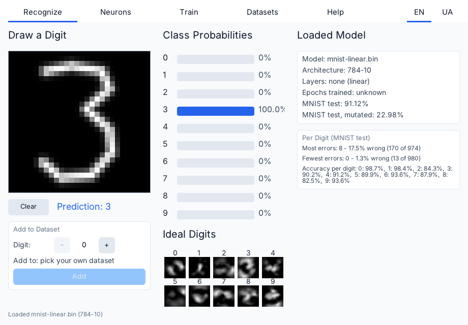
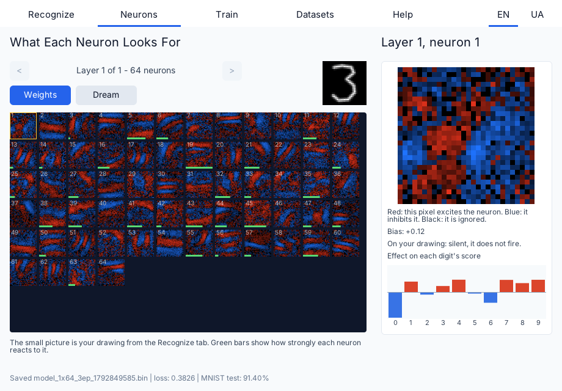
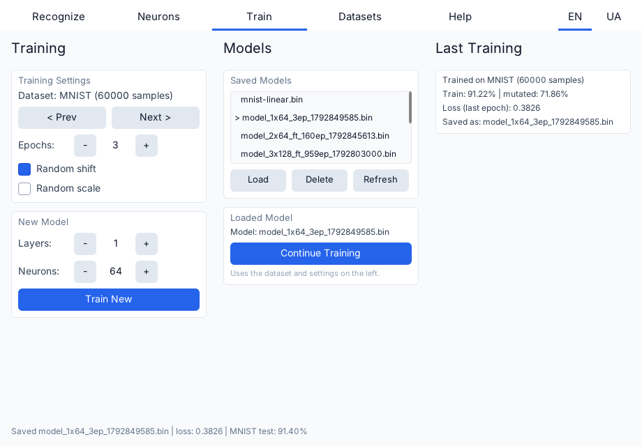
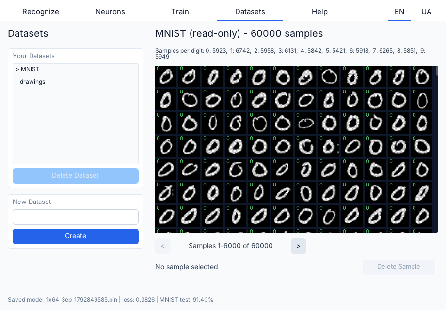
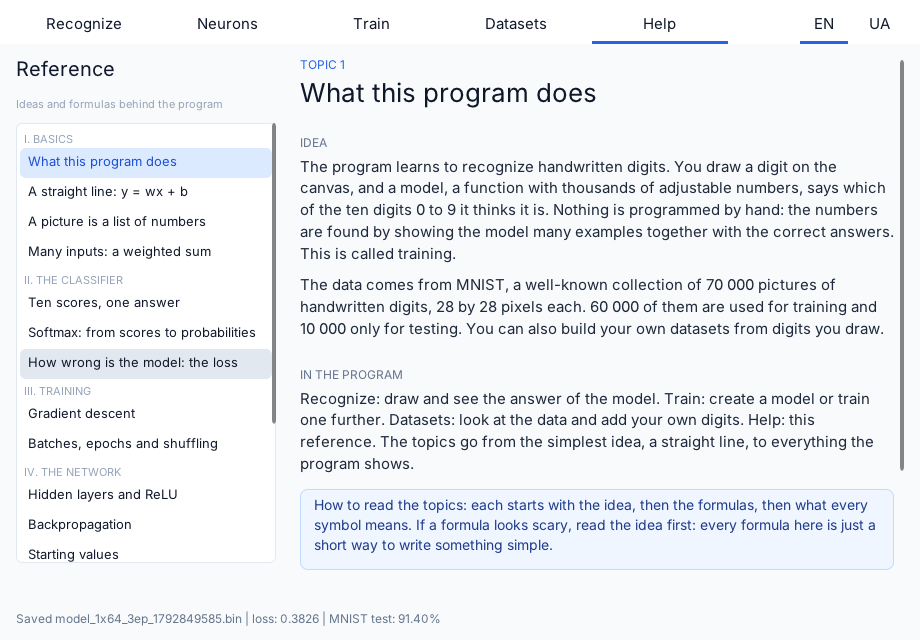

# Number Recognizer

An interactive MNIST digit classifier written in C++23 on top of the [Wind engine](https://github.com/wismh/wind-engine). You draw a digit, a small neural network tells you which one it is, and every part of the process is visible: the class probabilities, what each neuron looks for, how the network was trained, and the data it was trained on. A built-in reference explains the ideas and formulas behind each step.

The program is also a learning tool. You can train your own models, change the architecture, add your own handwritten samples to custom datasets, and see how that changes the result.



## Features

- **Recognize.** Draw a digit on a 28x28 canvas and see the probability of each class update while you draw. The tab shows the loaded model, its accuracy on the MNIST test set (as is, and with randomly shifted and scaled digits), the error rate per digit, and the ideal picture of each digit as the model sees it.
- **Neurons.** Browse every neuron of every layer as a picture of its weights, or as a "dream": the image that makes that neuron fire the hardest. Pick a neuron to see it large, its bias, how it reacts to your drawing, and how it pushes each digit's score up or down.
- **Train.** Train a new model or continue training a saved one. Choose the dataset, the number of epochs, the number of hidden layers (0 to 4) and neurons per layer (4 to 256), and optional random shift and scale augmentation. Models are saved automatically and can be loaded or deleted from the list.
- **Datasets.** Look at the 60 000 MNIST training samples as a grid, create your own datasets, add the digit you drew with a chosen label, and delete samples.
- **Help.** A reference in 17 short topics, from a straight line to backpropagation, each with the idea, the formulas, and where it appears in the program.
- **Two languages.** The interface and the reference are available in English and Ukrainian; the choice is remembered.

## Screenshots

### Neurons



### Train



### Datasets



### Help



## How it works

The model is a fully connected network: 784 inputs (the pixels divided by 255), a chosen number of ReLU hidden layers, and 10 softmax outputs. With no hidden layers it is a linear softmax classifier. Training is mini-batch stochastic gradient descent with cross-entropy loss (batch of 32, learning rate 0.1), spread over the engine's worker threads. Training and scoring run in short slices every frame, so the window stays responsive.

A digit drawn on the canvas is not fed to the network as is. When it is added to a dataset it is normalized the way MNIST digits are: scaled so the longer side is 20 pixels and centered by its center of mass.

## Build, run and export

The project is built, run and exported with the Wind Editor, which is part of the [wind-engine](https://github.com/wismh/wind-engine) repository. Get the editor from there and then:

1. Open the Wind Editor and open this folder as a project (it contains `wind_project.toml`).
2. Press **Play**. The editor builds the game module and starts the game.
3. To make a standalone build, use the editor's **Export**. The MNIST data from `data/mnist` is packed with the export, so the exported game needs no extra files.

The project targets the engine version written in `wind_project.toml`. Use the matching Wind SDK.

## Data and saved files

- The MNIST files (`data/mnist`) are part of the repository and are copied next to the build output, so a fresh checkout works without any download.
- Trained models and your own datasets are stored in the per-user data directory of the game (organization `wismh`, application `number-recognizer`), in the `model` and `datasets` folders. Nothing is written into the project folder.

## Project layout

```
src/
  model/        The domain: network, training, evaluation, augmentation, file formats.
                Has no engine dependencies.
  view/         Painters and view-model items for the UI.
  help/         The reference tab.
  loc/          Localization helpers.
  recognizer.*  Wires the screen to the domain.
  train_settings.*, model_library.*, training_session.*, digit_dreamer.*, dataset_manager.*, neuron_panel.*
                The parts of the screen behavior, one responsibility each.
assets/         UI (XML and CSS), strings, help topics.
data/mnist/     MNIST IDX files.
tests/          Unit tests of the domain.
docs/           Screenshots.
```

The domain code in `src/model` is built as a separate static library, `recognizer_model`, which the game module and the tests both link.

## Tests

The domain has unit tests (GoogleTest, taken from the Wind SDK) for the network and its gradients, the model and dataset file formats, training, evaluation, augmentation, normalization and the stores. They are off by default so that building in the editor does not compile them. To build and run them, configure with the `tests` preset and pass the path to the Wind SDK:

```
cmake --preset tests -DCMAKE_PREFIX_PATH=<path to the Wind SDK>
cmake --build build-tests --config Release
ctest --test-dir build-tests -C Release
```
